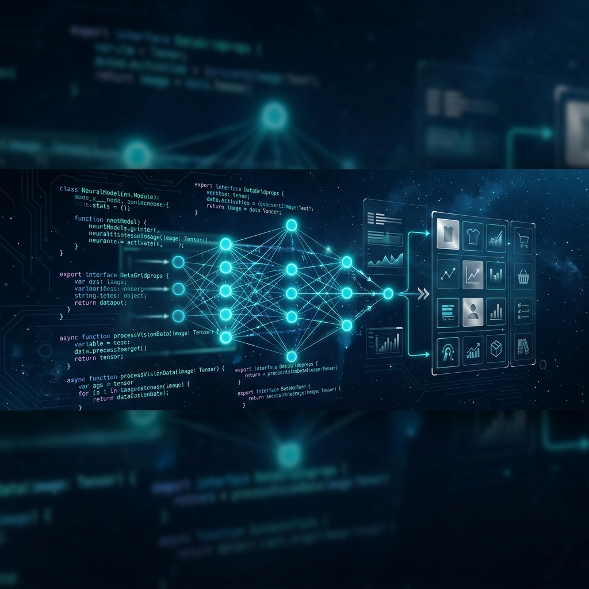
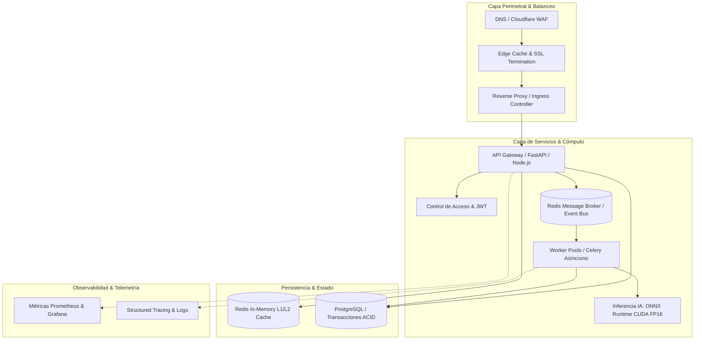

  

<h1 align="center">Bryan Montes · Thekerdruid</h1>

  

  
  
  
  
  
  

---

| Inferencia IA | Simulación Estocástica | Rendimiento Frontend | Integración Continua |
| :---: | :---: | :---: | :---: |
| **CUDA FP16 / Tensor Cores** `Inferencia sub-frame optimizada` | **> 1,000,000 giros/s** `CSPRNG Monte Carlo Engine` | **Lighthouse 95+ Score** `WebGL / 60 FPS Estables` | **GitHub Actions** `CI/CD Automatizado` |

---

## Perfil Profesional & Filosofía de Ingeniería

Desarrollador y arquitecto de software especializado en el diseño e implementación de **sistemas de alta concurrencia, pipelines avanzados de Inteligencia Artificial y arquitecturas web de alto rendimiento**. Mi enfoque de ingeniería combina modelado matemático, aceleración por hardware y diseño de infraestructuras desacopladas:

- **Arquitectura Limpia & Modular:** Construcción de sistemas basados en microservicios, eventos asíncronos y separación estricta de responsabilidades para garantizar mantenibilidad sin deuda técnica.
- **Rendimiento Extremo:** Optimización rigurosa de latencia: inferencia acelerada con CUDA/FP16, procesamiento distribuido y tiempos de carga sub-segundo con estrategias SSR/SSG.
- **Experiencias Interactivas 3D:** Integración de gráficos en tiempo real mediante WebGL y Three.js, alcanzando 60 FPS estables y puntuaciones Lighthouse 95+.

---

## Blueprint de Arquitectura de Referencia para Producción

Diseño de arquitectura distribuida implementado para sistemas que demandan alta disponibilidad, tolerancia a fallos y procesamiento concurrente:

---

## Proyectos Destacados (Showcase Grid)

<table>
  <tr>
    <td width="50%" valign="top">
      <h3>EXON-FACE</h3>
      
<b>Sistema de Visión Artificial & Procesamiento Facial</b>

      

        
        
        
        
      

      
Motor de análisis, segmentación y transposición facial de alta fidelidad diseñado para flujos de vídeo de calidad cinematográfica.

      <ul>
        <li><b>Segmentación BiSeNet:</b> Máscaras anatómicas a nivel de píxel (ojos, labios, piel).</li>
        <li><b>Restauración Generativa:</b> CodeFormer y GFPGAN integrados para baja resolución.</li>
        <li><b>Aceleración Hardware:</b> ONNX Runtime con Tensor Cores CUDA FP16.</li>
      </ul>
      

        <a href="https://github.com/bmontes93/EXON-FACE"><b>[Ver Código Fuente]</b></a> &nbsp;
        <a href="https://github.com/bmontes93/EXON-FACE#readme"><b>[Documentación]</b></a>
      

    </td>
    <td width="50%" valign="top">
      <h3>Motor Predictivo ML</h3>
      
<b>Pipeline Cuantitativo & Value-Betting Deportivo</b>

      

        
        
        
        
      

      
Sistema analítico continuo de extracción masiva en tiempo real, modelado estadístico y detección de ineficiencias de mercado.

      <ul>
        <li><b>Orquestación por Fases:</b> T-24h contexto, T-12h cuotas base, T-60m alineaciones y T-55m inferencia.</li>
        <li><b>Modelado Probabilístico:</b> Cálculo de probabilidad real (<code>P_bot</code>) sobre mercados de alta liquidez.</li>
        <li><b>Ventaja Matemática:</b> Margen probabilístico (<code>(1 / P_bot) * (1 + α) &lt; Cuota</code>).</li>
      </ul>
      

        <b>[Sistema Propietario en Producción]</b>
      

    </td>
  </tr>
  <tr>
    <td width="50%" valign="top">
      <h3>quantslot-sdk</h3>
      
<b>Motor Matemático & Simulación Estocástica</b>

      

        
        
        
        
      

      
Motor matemático de simulación probabilística y certificación de juegos conforme a estándares técnicos GLI y iTech Labs.

      <ul>
        <li><b>Simulador Masivo:</b> Evaluación de millones de tiradas en segundos para certificar RTP y volatilidad.</li>
        <li><b>Mecánicas Dinámicas:</b> Matrices Cluster-Pay (5x5), cascadas infinitas y bonificaciones.</li>
        <li><b>Aleatoriedad CSPRNG:</b> Entropía criptográfica sin sesgos ni predictibilidad.</li>
      </ul>
      

        <a href="https://github.com/bmontes93/quantslot-sdk"><b>[Ver Código Fuente]</b></a> &nbsp;
        <a href="https://github.com/bmontes93/quantslot-sdk#readme"><b>[SDK Reference]</b></a>
      

    </td>
    <td width="50%" valign="top">
      <h3>TAHUAGYM</h3>
      
<b>Plataforma Web 3D & Alto Rendimiento</b>

      

        
        
        
        
      

      
Plataforma web comercial orientada a una experiencia interactiva inmersiva, logrando puntuaciones de rendimiento sobresalientes.

      <ul>
        <li><b>Arquitectura SSR/SSG:</b> App Router con React Server Components y bundle optimizado.</li>
        <li><b>Visualizador 3D:</b> Three.js y React Three Fiber con geometrías optimizadas a 60 FPS estables.</li>
        <li><b>SEO & Accesibilidad:</b> WCAG AA compliant y datos estructurados JSON-LD.</li>
      </ul>
      

        <b>[Plataforma Comercial Desplegada]</b>
      

    </td>
  </tr>
</table>

---

## Dominios de Especialidad & Competencias Técnicas

| Área Técnica | Stack Clave | Enfoque de Ingeniería |
| :--- | :--- | :--- |
| **IA & Visión Artificial** | Python · ONNX Runtime · NVIDIA CUDA · OpenCV · InsightFace | Inferencia en tiempo real (FP16), segmentación facial y restauración generativa |
| **Machine Learning & Big Data** | XGBoost · LightGBM · Celery · Redis · PostgreSQL · Playwright | Orquestación distribuida, pipelines reactivos y modelos cuantitativos |
| **Sistemas & iGaming Math** | Node.js · TypeScript · Simulaciones Monte Carlo · CSPRNG | Simulación estocástica masiva (millones de giros/s) y certificación matemática |
| **Frontend Moderno & 3D Web** | Next.js 15 · React 19 · Three.js · React Three Fiber · TailwindCSS | Renderizado 3D a 60 FPS estables, Server Components y accesibilidad AA |

---

## Patrones de Arquitectura, Seguridad & I+D

- **Patrones Arquitectónicos:** Segregación CQRS, Arquitectura Orientada a Eventos (EDA), Máquinas de Estado Finito (FSM) para procesos transaccionales y patrón Repositorio / Service Layer desacoplado.
- **Seguridad & Hardening:** Generación criptográfica CSPRNG certificable, validación estricta de esquemas en runtime con Pydantic y Zod, hashing Argon2/bcrypt, JWT con rotación y rate-limiting en memoria con Redis.
- **Investigación Activa (I+D):** Inferencia local de LLMs mediante cuantización GGUF/AWQ con vLLM, compilación de algoritmos matemáticos a WebAssembly con Rust y patrones Event Sourcing.

---

## Stack Tecnológico

  

  
  
  
  
  
  
  
  
  
  
  
  

---

## Métricas de Rendimiento & Benchmarks Cuantitativos

| Sistema / Proyecto | Métrica Principal | Benchmark / Resultado Técnico | Entorno de Ejecución |
| :--- | :--- | :--- | :--- |
| **EXON-FACE** | Latencia de inferencia por frame | Reducción significativa de tiempo de procesamiento vs FP32 | NVIDIA CUDA / Tensor Cores |
| **Motor Predictivo ML** | Ventana de ejecución de inferencia | Pipeline de ingesta, cálculo y alerta completado en <90s | Celery Workers + Redis Cache |
| **quantslot-sdk** | Throughput de simulación estocástica | Millones de tiradas simuladas y analizadas en segundos | Node.js V8 Engine / In-Memory |
| **TAHUAGYM** | Core Web Vitals (Lighthouse) | 95+ Performance, 100 Accesibilidad, 100 SEO | Next.js Server Components |

---

<b>Ver proyectos adicionales de arquitectura y software especializado</b>

 

#### Ecosistema SaaS de Automatización & Pagos para Telegram
> **Python · aiogram 3 · FastAPI · PostgreSQL · SQLAlchemy 2.0 · Redis · APScheduler · Docker**
* Arquitectura distribuida para control de accesos, verificación de comprobantes mediante máquinas de estado finito (FSM), alertas con APScheduler y campañas segmentadas.

---

#### ALL-DAY — Plataforma SaaS para Gestión de Eventos
> **Next.js 15 · React 19 · TypeScript · PostgreSQL · Prisma ORM · Culqi · Resend · Pusher**
* Sistema de reservas y pagos fraccionados (anticipo del 50%) con Culqi, verificación de identidad y notificaciones push nativas vía Service Workers.

---

#### [CALC101NG](https://github.com/bmontes93/CALC101NG) — Motor de Cálculo Simbólico y Gráficas Dinámicas
> **React · TypeScript · Vite · MathLive · Function-Plot · Python · FastAPI · SymPy · Docker**
* Backend asíncrono con FastAPI y SymPy para simplificación algebraica analítica en milisegundos y editor visual interactivo WYSIWYG con MathLive.
* **[Código Fuente](https://github.com/bmontes93/CALC101NG)** &nbsp;·&nbsp; **[Documentación de API](https://github.com/bmontes93/CALC101NG#readme)**

---

#### [GEST E-Commerce](https://github.com/bmontes93/GEST-E-COMERCE) — Arquitectura E-Commerce Desacoplada
> **TypeScript · React · Vite · Python · FastAPI · Docker Compose · JWT**
* Microservicios contenerizados de despliegue independiente mediante Docker Compose y panel administrativo integral para inventario y órdenes.
* **[Código Fuente](https://github.com/bmontes93/GEST-E-COMERCE)**

---

#### [Hide-Clone-USB](https://github.com/bmontes93/Hide-Clone-USB) — Servicio de Sincronización Orientado a Eventos
> **PowerShell · Robocopy (32 Hilos) · Windows Task Scheduler**
* Respaldo reactivo desencadenado por eventos de kernel de Windows (`DriverFrameworks`), sin consumo continuo de CPU por sondeo y copia masiva a 32 subprocesos.
* **[Código Fuente](https://github.com/bmontes93/Hide-Clone-USB)**

---

## Disponibilidad Profesional & Contacto

Disponible para posiciones senior de ingeniería, liderazgo técnico y consultoría de arquitectura de sistemas:

- **Roles de Interés:** Senior Full Stack Engineer · Tech Lead · Especialista en Inferencia de IA & Arquitectura Backend.
- **Modalidad:** Remoto internacional / Híbrido.
- **Zona Horaria:** UTC-5 (disponibilidad operativa para alineación con equipos en EE.UU., LATAM y Europa).
- **Canal Directo:** [LinkedIn](https://www.linkedin.com/in/bmontesdev/) &nbsp;|&nbsp; [bmontesr930620@gmail.com](mailto:bmontesr930620@gmail.com) &nbsp;|&nbsp; [bmontesdev.me](https://bmontesdev.me)

---

## Métricas de Actividad

  
  

---

  <i>"Transformando requerimientos de alta complejidad en arquitecturas de software robustas, eficientes y escalables."</i> 
  <b>Bryan Montes · Thekerdruid</b>

