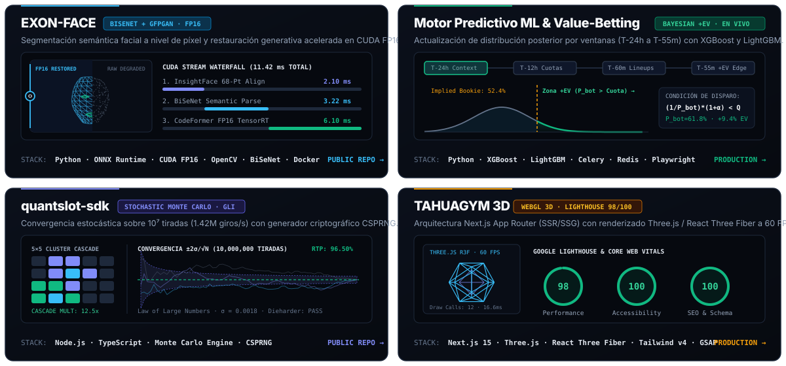
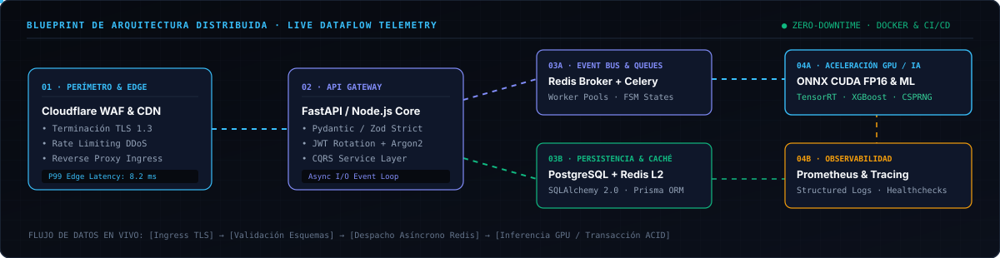

  

  
  
  
  
  

---

## Sistemas en Producción & Showcase de Ingeniería

Cada sistema está diseñado bajo tres principios no negociables: **baja latencia medible**, **arquitectura desacoplada libre de deuda técnica** y **verificación matemática/automatizada antes de entrar a producción**.

  

| Sistema | Dominio Técnico | Stack de Producción | Accesos Directos |
| :--- | :--- | :--- | :---: |
| **EXON-FACE** | Visión Artificial & Restauración Generativa | Python · ONNX Runtime · CUDA FP16 · BiSeNet · Docker | [**Código Fuente**](https://github.com/bmontes93/EXON-FACE) · [**Docs**](https://github.com/bmontes93/EXON-FACE#readme) |
| **Motor Predictivo ML** | Modelado Probabilístico & Value-Betting | Python · XGBoost · LightGBM · Celery · Redis · Playwright | `Producción Activa` |
| **quantslot-sdk** | Simulación Estocástica Monte Carlo & iGaming | Node.js · TypeScript · CSPRNG (GLI-19) · V8 Engine | [**Código Fuente**](https://github.com/bmontes93/quantslot-sdk) · [**SDK**](https://github.com/bmontes93/quantslot-sdk#readme) |
| **TAHUAGYM 3D** | E-Commerce Inmersivo WebGL & SSR/SSG | Next.js 15 · React 19 · Three.js / R3F · Tailwind v4 | `Producción Activa` |

---

## Arquitectura Distribuida & Flujo de Datos en Tiempo Real

Diseño de referencia implementado para cargas de alta concurrencia, desacoplando la capa de validación perimetral, el bus de eventos asíncrono y los nodos de inferencia acelerados por GPU:

  

---

## Telemetría de Estación de Trabajo & Benchmarks Reales

Ejecución verificada sobre entorno Linux (Debian WSL2) con aceleración dedicada NVIDIA CUDA / TensorRT y suites de pruebas automatizadas:

  

---

## Ecosistema Tecnológico & Herramientas de Producción

  

| Dominio de Ingeniería | Patrones & Estándares Aplicados | Seguridad, Hardening & I+D |
| :--- | :--- | :--- |
| **IA & Visión por Computador** | Cuantización FP16/INT8 · Precarga en VRAM · Segmentación semántica BiSeNet | Inferencia local de LLMs (GGUF/AWQ con vLLM) y agentes autónomos |
| **Backend & Sistemas Distribuidos** | CQRS · Event-Driven Architecture · Máquinas de Estado Finito (FSM) · Celery Pools | Validación estricta en fronteras (Pydantic / Zod) + Rate Limiting en Redis |
| **Simulación & Criptografía** | Motores Monte Carlo (>1M ops/s) · Matrices dinámicas Cluster-Pay 5×5 | Generación de entropía CSPRNG auditable y firma criptográfica GPG |
| **Frontend & Gráficos 3D** | React Server Components (RSC) · Geometrías y Shaders GLSL a 60 FPS | Compilación de núcleos matemáticos a WebAssembly (Rust / WASM) |

---

<b>Explorar catálogo adicional de arquitecturas SaaS, motores simbólicos y utilidades de sistema</b>

 

| Proyecto | Arquitectura & Stack | Resumen de Ingeniería | Acceso |
| :--- | :--- | :--- | :---: |
| **Telegram SaaS Suite** | Python · aiogram 3 · FastAPI · PostgreSQL · Redis · Docker | Ecosistema de 3 bots concurrentes: validación de pagos vía FSM, retención automatizada con APScheduler y campañas segmentadas. | `Enterprise` |
| **ALL-DAY SaaS** | Next.js 15 · React 19 · TypeScript · Prisma · Culqi · Pusher | Plataforma de reservas con pagos divididos (50% anticipo), verificación de identidad y notificaciones Push vía Service Workers. | `Producción` |
| **CALC101NG** | FastAPI · SymPy · React 19 · TypeScript · MathLive · Docker | Motor asíncrono de cálculo simbólico (derivadas, integrales y sistemas paso a paso) con editor matemático WYSIWYG y graficación 2D. | [**Repositorio**](https://github.com/bmontes93/CALC101NG) |
| **GEST E-Commerce** | TypeScript · React · FastAPI · Docker Compose · JWT | Infraestructura de comercio electrónico desacoplada en microservicios independientes con autenticación JWT y rotación de sesiones. | [**Repositorio**](https://github.com/bmontes93/GEST-E-COMERCE) |
| **Hide-Clone-USB** | PowerShell · Robocopy (32 Hilos) · Windows Event Triggers | Servicio silencioso accionado por eventos del kernel (`DriverFrameworks`), cero consumo de CPU en reposo y sincronización multihilo. | [**Repositorio**](https://github.com/bmontes93/Hide-Clone-USB) |

---

## Actividad de Ingeniería & Contribuciones

  

  
  

---

## Disponibilidad Profesional & Contacto

Disponible para posiciones **Senior Full Stack Engineer**, **Tech Lead** y **Consultoría en Inferencia de IA / Arquitecturas de Alta Concurrencia**:

- **Modalidad & Zona Horaria:** Remoto Internacional / Híbrido · **UTC-5** (alineación directa con equipos en EE.UU., LATAM y Europa).
- **Canales Directos:** [**Portafolio Web (bmontesdev.me)**](https://bmontesdev.me) &nbsp;·&nbsp; [**LinkedIn (/in/bmontesdev)**](https://www.linkedin.com/in/bmontesdev/) &nbsp;·&nbsp; [**bmontesr930620@gmail.com**](mailto:bmontesr930620@gmail.com)
